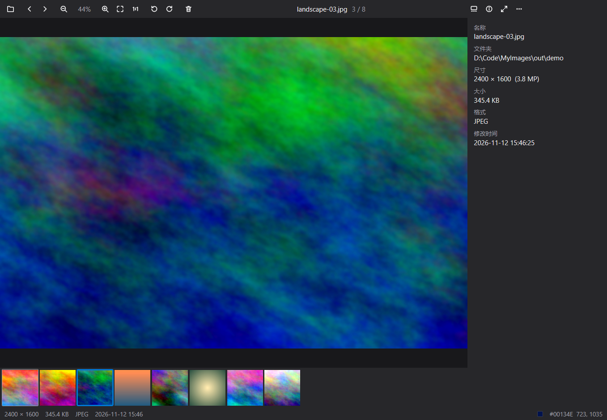

<p align="center">
  
</p>

<h1 align="center">MyImages</h1>

<p align="center">
  <a href="https://github.com/f1sherb0y/MyImages/releases/latest">下载安装包</a>
</p>

一个快、紧凑的 Windows 看图软件。界面用 [MyGo](https://github.com/egoist/mygo) 的原生 UI 在 GPU 上画，纯 Go，没有 cgo，单个 22.6 MB 的 exe，安装包 8.8 MB。



- **快**：双击一张 3200 万像素的照片，到它出现在屏幕上约 0.18 秒；切到下一张约 25 毫秒。同一台机器、同一张照片、同一把秒表，ImageGlass 10 是 0.74 秒和 0.55 秒。测法和完整数字见 [docs/benchmark.md](docs/benchmark.md)。
- **省**：看这张照片时占 120 MB 内存（ImageGlass 10：1.3 GB），空闲时不用 CPU。
- **格式多**：JPEG、PNG、GIF、WebP、BMP、TIFF、ICO、HEIC/HEIF、AVIF、JPEG XL、JPEG 2000、JPEG XR、DDS、SVG、PSD、EXR、HDR、TGA、QOI、PCX、PNM、FITS、EMF/WMF、XBM/XPM……和四十多种相机 RAW。全部在进程内解码（Windows 自带的解码器和编进 exe 的 Go 库），不依赖用户另外装任何东西。完整的表见 [docs/design.md](docs/design.md#格式)。
- **动图**：GIF、APNG、动态 WebP 直接播放。
- **缩放和拖动**：滚轮以指针为中心缩放，拖动平移，双击在「适应窗口」和 100% 之间切换；放大后像素保持锐利（可在设置里改成平滑）。
- **缩略图条、信息面板**（拍摄时间、相机、镜头、曝光、位置）、状态栏里指针下的颜色。
- **旋转、翻转、幻灯片、全屏**，复制图片或路径、重命名、删除到回收站、设为桌面背景、打印、打开方式。
- **多语言**：英文和简体中文，默认跟随系统。
- **自动更新**：启动时立刻在后台检查 GitHub 上的新版本并下载，好了之后标题栏出现「重启以更新」，点一下就是新版，还停在刚才那张图上。

## 安装

到 [Releases](https://github.com/f1sherb0y/MyImages/releases/latest) 下载 `myimages-setup-<版本>-amd64.exe` 运行即可，只装给当前用户，不需要管理员权限；同一页的 `MyImages-<版本>-portable-amd64.exe` 是免安装的单个文件（不会自动更新）。安装包没有代码签名，Windows 可能会提示「未知发布者」。

安装后图片的「打开方式」里会有 MyImages；要设成默认，在设置（Ctrl+,）里点「默认应用…」。

## 快捷键

| | |
|---|---|
| ← / →、PageUp / PageDown、空格 / 退格、鼠标侧键 | 上一张 / 下一张 |
| Home / End | 第一张 / 最后一张 |
| + / -、↑ / ↓、滚轮 | 放大 / 缩小 |
| 0 / 1、双击、中键 | 适应窗口 / 实际大小 |
| R / L、H | 向右 / 向左旋转、水平翻转 |
| , / . | 多页文件（TIFF、ICO）的上一页 / 下一页 |
| F11、F、Alt+Enter | 全屏 |
| S、F12 | 幻灯片 |
| T / I / B | 缩略图 / 信息 / 背景色 |
| Ctrl+O、Ctrl+V | 打开、打开剪贴板里的文件 |
| Ctrl+C、Ctrl+Shift+C | 复制图片、复制路径 |
| F2、Delete、Shift+Delete | 重命名、删除到回收站、永久删除 |
| Ctrl+E、Ctrl+P | 在资源管理器中显示、打印 |
| F5 | 重新加载 |
| Ctrl+, | 设置 |
| Esc | 退出全屏 / 关闭 |

按住 Ctrl 滚轮是切换图片（设置里可以把两者对调）。把文件或文件夹拖进窗口就打开它。

## 构建和运行

需要 Go 1.27。

```powershell
.\tools\setup-mygo.ps1               # 只需一次：取 MyGo 0.9.0 并打上 patches\mygo.patch
go tool mygo build -skip-installer . # 生成 build\windows-amd64\MyImages.exe
go tool mygo build .                 # 连同安装包
go test ./...                        # 测试（不弹窗口）
```

`.github/workflows/ci.yml` 在每次推送时测试并构建安装包；推一个 `v1.2.3` 这样的标签，`release.yml` 就按这个版本构建、签名更新包并发布到 Releases，已安装的程序随后自己更新。发布需要仓库 secret `MYGO_UPDATER_PRIVATE_KEY`（见 [docs/design.md](docs/design.md#自动更新)）。

## 文档

- [docs/design.md](docs/design.md)：分层、为什么快、格式、从 ImageGlass 学了什么、MyGo 的补丁。
- [docs/benchmark.md](docs/benchmark.md)：实测数字和测法。
